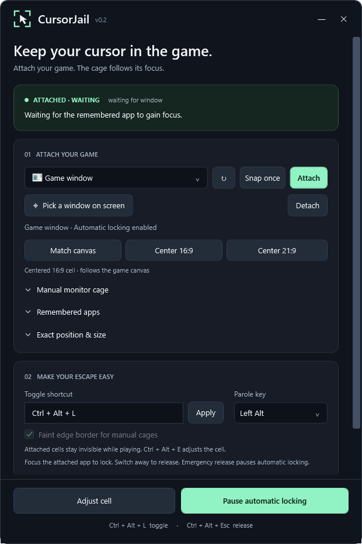

# CursorJail


A visual cursor cage for Windows. **Attach a game once**: its cell locks when the selected window has focus, releases when you switch apps, and follows the game as it moves or resizes. Choose a full game canvas, a centered 16:9 or 21:9 cell, or custom margins.

Built with **C#, WPF and .NET 10 LTS**. Uses Windows `ClipCursor` for confinement, a click-through overlay, and passive foreground events. No game-process injection or cursor teleporting.



## Run

Download `CursorJail-win-x64.zip` from this repository's Releases, extract it, and open **CursorJail.exe**. The portable package includes .NET; no installation or administrator access is needed. Windows 10/11, x64. The executable is currently unsigned.

Exit an older running copy before opening the update.

1. Pick your game from the icon dropdown and click **Attach**, or choose **Pick a window on screen**, then click the game. The selection click is consumed.
2. The editor starts at the remembered cell or actual client area. Drag to move and resize its edges. **Done** returns to the game; clicking back into the game also finishes editing.
3. The overlay hides during automatic play. Focus the game to lock; Alt+Tab or click another app to release. Return to the selected game window to lock again.
4. Hold the **Parole key** to pass through: Left Alt, middle mouse, mouse back or mouse forward. If a side-click changes focus, remain free until the game returns.
5. **Ctrl + Alt + Esc** releases and pauses automatic locking until you explicitly resume. Emergency pause, editing cancellation, session/display changes and cursor errors require resumption.

**Ctrl + Alt + L** (customizable) pauses/resumes an attached cell or toggles a manual cage. **Ctrl + Alt + E**, when available, opens/finishes the cell editor. Existing toggles are preserved, including Ctrl+Alt+E; when it is your toggle, use the editor button or tray menu instead.

Starting the app never locks the mouse. A remembered attachment waits for a new focus event. Normal exit preserves the enabled preference; emergency pause stays paused across restarts. CursorJail must be running for automatic locking to work.

The panel's **—** button hides it to the tray. Double-click the tray icon to reopen it. **✕** or **Exit CursorJail** releases and exits. The tray includes pause/resume, editing, saved cages and release. Automatic play never activates the panel or overlay; explicit edit/pick actions activate their temporary UI.

## Features

- **Match canvas** reads GetClientRect and ClientToScreen. Windowed games exclude native chrome; borderless games retain full client height. No fixed 30-pixel trim. [Microsoft documentation](https://learn.microsoft.com/en-us/windows/win32/api/winuser/nf-winuser-getclientrect).
- **Center 16:9 / Center 21:9** fit the live game canvas and retain their aspect as it resizes. CursorJail does not detect black bars or change rendering resolution.
- Drag/resize an attached cell without detaching. Custom margins are fractions of the client size, preserving relative placement during movement, resizing and DPI changes. Minimum: 160 × 100 physical pixels.
- Up to 20 remembered app profiles save executable full path, window class and cell settings. WPF class GUIDs are normalized for relaunch; live bindings check the exact class and process ID. HWNDs and process IDs are never saved.
- A live attachment stays bound to the selected window rather than switching to a sibling. After it closes, a matching foreground window may reattach. Only the selected app profile is active; use **Remembered apps** to choose or forget another.
- **Detach** returns to a manual rectangle while keeping the remembered profile available. **Snap once**, manual monitor layouts and saved cages retain manual focus behavior: use the toggle after focus loss. Choosing a manual layout detaches automatic mode.
- The editor temporarily takes foreground focus for sizing. During attached play it hides entirely; the native cursor fence remains. The faint edge border is available for manual cages.
- A guarded 50 ms watchdog repairs a cleared clip only while the selected target remains focused. Native window movement releases the cage until the drag ends. Automatic waiting checks focus/liveness; paused and manual-idle timers stop.
- Custom toggle, optional editor shortcut and permanent emergency release. Missing essential shortcuts/focus monitoring disable confinement. Failed release retries and cannot re-lock.
- Up to 20 named manual cages, per-monitor V2 DPI awareness and single-instance operation. Settings are saved atomically in `%LOCALAPPDATA%\CursorJail\settings.json`.
- Version 1 settings migrate with regions, presets and custom shortcuts preserved; the source is backed up before the first version 2 save. Corrupt/future settings and invalid app-profile sources are backed up before replacement.

## Build and verify

Requires Windows and the .NET 10 SDK. No third-party runtime packages.

```powershell
dotnet build CursorJail.slnx --configuration Release
dotnet run --project tests/CursorJail.Specs --configuration Release --no-build
# Native identity/HWND/DPI/style checks and off-screen renders; never locks the cursor.
src/CursorJail/bin/Release/net10.0-windows/CursorJail.exe --smoke-test artifacts/smoke
# Build, verify and publish a portable ZIP:
pwsh -NoProfile -File tools/Publish.ps1
# Optional Windows ARM64 package:
pwsh -NoProfile -File tools/Publish.ps1 -Runtime win-arm64
```

GitHub Actions builds on Windows, runs the core specifications, and uploads the self-contained x64 package. Regenerate the icon with `tools/New-Icon.ps1` after changing its drawing.

## Implementation

`CursorJail.Core` contains physical-pixel geometry, the confinement state machine, attachment coordination and settings. `CursorJail` supplies the WPF UI, native adapter, shortcuts, focus/move hooks, tray and lifecycle handling. The specifications cover manual/automatic safety, geometry, identity/relaunch and migration. Native smoke checks include executable identity, client coordinates, picker hit-testing and editor/attached-mode UI renders.

Windows owns the cursor as a shared resource. CursorJail releases only clips it has acquired. Focus and escape checks always run before watchdog repair. A failed release enters a retry state and cannot re-lock. See the [ClipCursor documentation](https://learn.microsoft.com/en-us/windows/win32/api/winuser/nf-winuser-clipcursor).

WPF initializes DPI from the manifest; Windows Forms is used for the tray icon only. The WinForms-only WFO0003 analyzer is therefore suppressed in the WPF project.

## Practical limits

Intended for windowed and borderless games. Exclusive fullscreen and individual Fullscreen Optimizations behavior require game-specific testing. Raw-input cameras and game edge-scrolling rules remain independent of the cell. Custom title bars drawn inside a client area may need manual margins.

Executable moves or class changes may require reattachment. Protected process identity queries fail safely. External Win32 APIs avoid injection, but anti-cheat compatibility is not certified. Automated tests do not replace actual game or physical mixed-DPI testing. See [manual acceptance checks](docs/MANUAL-TESTS.md).
